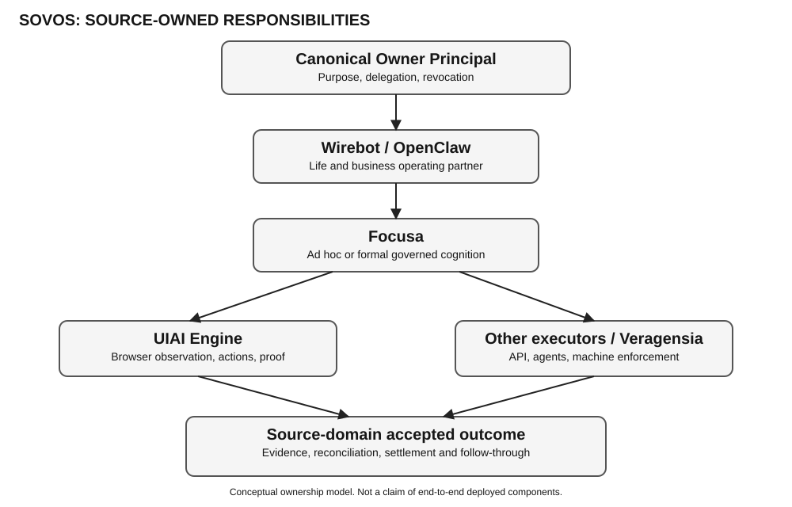
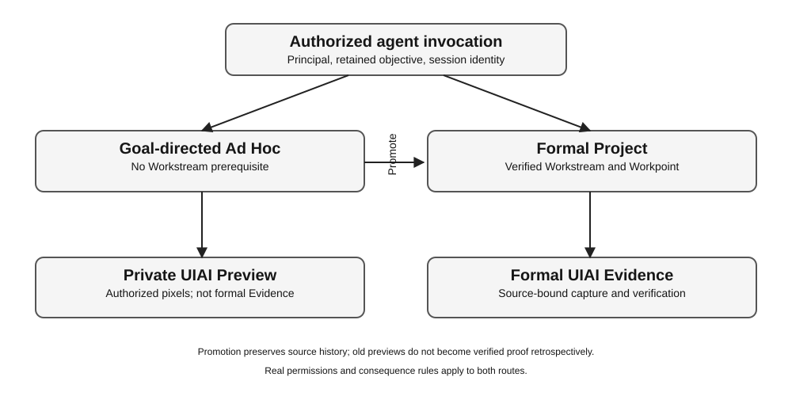
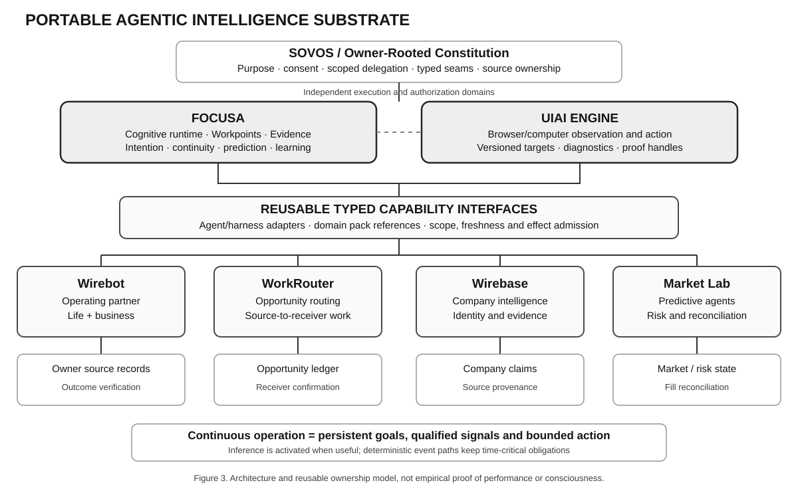
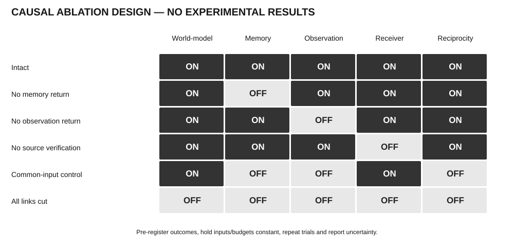

**Manuscript status.** Revised source-grounded architecture and evaluation protocol (v0.3); not yet submitted to arXiv. The accompanying Cross-System Fidelity Audit and the ad hoc acceptance issues identify proposed software alignment decisions; the present manuscript does not approve them. Claims about implementations are tied to the public source snapshots in Appendix A. Normative specifications are not represented as completed deployments, and the results section intentionally contains no invented measurements.

# 1. Introduction

The proposed shift from application-centric software to persistent agent-operated systems is frequently explained through increasingly capable agents and access to more tools. Yet the central difficulty is not merely finding an agent capable of taking an action. It is preserving legitimate *purpose*, *scope*, *authority*, and *evidence* through a chain of heterogeneous software systems and changing execution contexts. A browser can report that a button was clicked while the underlying transaction failed; a resumed agent can remember the task while using a different project; a visually plausible interface can hide a changed page; a workflow can complete its steps without fulfilling the owner's intended outcome. These distinctions become consequential when agents work across sessions, computers, businesses, and personal domains.

SOVOS (Sovereign Operating System) is an architecture and portable operating doctrine for an owner-directed, agent-driven life-and-business system, **not** an additional runtime or centralized database [S1]. It provides portable laws for ownership, typed meaning, provenance, tenancy, authority, freshness, causal correlation, evidence, and source-owned outcomes. The public reference composition associates the owner-facing operating-partner role with Wirebot/OpenClaw, canonical workstream cognition and governance with Focusa, browser/computer observation and execution with UIAI Engine, and machine enforcement and operating environments with their respective owners [S1–S4]. An optional interface or network service does not acquire canonical authority by displaying information or relaying a command.

This paper makes a systems argument: **a credible agentic operating system must separate reasoning, action, observation, verification, and authority even when the user experiences them as one continuous relationship.** It develops a conceptual model of the Focusa–UIAI Engine seam within SOVOS and identifies assertions that can be evaluated or falsified. The reference design is motivated by long-horizon software work but applies also to bounded life and business operations. The same ownership law applies to both: a calendar remains authoritative for its events, a CRM for its customer records, and Focusa for its own governed work objects.

Our contributions are fivefold. First, we specify a typed, owner-rooted *information constitution* that does not depend on a global database. Second, we formalize a mission-preserving, evidence-bound execution loop from human intent to source-domain acceptance. Third, we connect Focusa's exact scoped continuation with UIAI's versioned browser observations, influence controls, and action/verification contracts. Fourth, we distinguish goal-directed ad hoc sessions from formal Workstream admission without weakening effect-level authorization. Fifth, we propose falsifiable tests for reciprocal causal integration, the operating partner self-model, and a separate finite IIT 4.0 model, alongside conditional safety properties and outcome-centered metrics. A sixth contribution is a **cross-vertical portability hypothesis**: the same Focusa/ UIAI interaction primitives can be embedded in Wirebot, WorkRouter, Wirebase and Market Lab, while each application retains independent source facts and outcome verification. Unlike a claim of universal intelligent performance, this proposition can be tested with matched agent arms, synthetic domain adapters, 24-hour duty-cycle trials and falsifiable source-owned acceptance oracles.

# 2. Related Work and Distinguishing Research Question

ReAct demonstrated an interleaving of language-model reasoning and external action [1]. AutoGen and AgentScope investigated flexible multi-agent communication and infrastructure, with AgentScope also employing actor-based distribution [2,3]. MemGPT framed persistent memory using an operating-system analogy, while AIOS investigated scheduling, resources, and an agent-oriented kernel [4,5]. WebArena and OSWorld provide reproducible browser and computer-use benchmarks [6,7]. These are complementary lines of work rather than substitutes for the particular problem considered here.

The narrower question of this paper is: **Under what compositional contracts can independently implemented agent, cognition, browser, infrastructure, and application systems jointly execute long-horizon work without silently transferring authority or treating unverified activity as an accepted outcome?** Our emphasis is on semantic ownership and cross-system correctness conditions, rather than a new language model, a new agent scheduler, or an assertion that every component resides in one monolithic kernel. The architecture may use actor runtimes, persistent jobs, or multiple harnesses without making their particular implementation the source of owner authority. A further **falsifiable portability claim** distinguishes this approach: the same source-agnostic cognitive and interaction invariants can be implemented across heterogeneous domain adapters, with successful outcomes confirmed by independent domain owners. Merely sharing a library, codebase, naming convention or model prompt is not evidence of that property.

# 3. Method and Evidence Classification

This is a design-science and contract-analysis manuscript. The primary materials are the public SOVOS architecture and seam documents [S1,S2], Focusa's canonical authority and Golden Workflow documents plus current Rust types [S3,S5], and UIAI Engine's agent-first browser specifications, TypeScript contract definitions, and Go evidence packet implementation [S4,S6,S7]. Source versions were pinned to repository commits dated 19–20 November 2026 (Appendix A). The analysis proceeds by extracting explicit responsibilities, constructing a formal compositional model, comparing source-defined identifiers and API assumptions across repos, deriving conditional consequences, and specifying executable tests that could establish implementation conformance. We also inspect source-level counterexamples: an exact Workstream ID in one system can be collapsed into a root/continuity-derived key in a consumer, even while the normative contracts prohibit such authority inference [S9–S11].

We label each statement by *evidence class*:

* **Implemented artifact:** a source file, type, function, schema, or test exists in the inspected revision; existence alone does not certify an end-to-end deployment.
* **Normative contract:** a specification states a required invariant or behavior; a corresponding test must verify enforcement.
* **Research proposition:** a conditional consequence of explicit assumptions; it is not a measured result.
* **Evaluation target:** a metric, baseline, or test defined for future experimental execution.

The separation prevents a conceptual blueprint, partial implementation, and field-verified operating system from being conflated. It also makes the present design externally auditable.



*Figure 1. Responsibility boundaries in the reference composition. Arrows depict permitted typed handoffs; domain truth remains with each owning system.*

# 4. Compositional System Model

## 4.1 Owners, actors, and domains

Let a SOVOS deployment be a family of interacting domains

$$\mathcal{D}=\{D_{owner},D_{partner},D_{work},D_{browser},D_{machine},D_{source,1},\ldots,D_{source,n}\}.$$

Each domain $D_i$ has a designated **domain-state owner** $c(D_i)$ for the state it is entitled to define. This is distinct from the *Canonical Owner Principal*, which authorizes the deployment's constitutional structure and may explicitly delegate bounded human or agent operations. Individual source domains continue to own their native records [S1,S2]. A projection, cached copy, summarization, or cross-domain reference does not create a second canonical owner. This principle permits integration without a universal life/business information database.

For external coordination, SOVOS defines a conceptual typed reference

$$r=\langle\mathrm{domain},\mathrm{kind},\mathrm{id},\mathrm{owner?},\mathrm{environment?}\rangle,$$

where the identifier is opaque outside its owner contract. A reference establishes addressability, **not** entitlement, truth, or authority [S2]. Before consequential use, a consumer must resolve the reference through the owning domain and verify scope, revision/freshness, and current authorization.

## 4.2 Scoped cognitive state

A Focusa work context is not identical to a conversational transcript or process session. Its canonical binding requires a verified project boundary and the exact work identity, which can be represented schematically as

$$k=\langle\mathrm{ScopeRef/ProjectRootKey},\mathrm{WorkstreamId},\mathrm{ContinuityId},\mathrm{AttachmentKey?}\rangle.$$

The applicable attachment is required when relevant; `project_root + continuity_id` alone does not form complete cognitive authority [S3]. In particular, a derived root/continuity string is not interchangeable with a verified, explicit `WorkstreamId`; older adapters must treat that pair as a lookup candidate, with ambiguity rejected rather than resolved by recency [S9–S11]. Within this scope, a High-Level Trajectory (HLT) is refined into Mid-Level Goals (MLGs), Short-Term Goals (STGs), and Waypoints. A **Workpoint** supplies immediate continuation authority in its accepted context, while **Evidence refs** carry proof and **Context Authority** governs risky mutation. Session identifiers are runtime metadata, not canonical mission identities.

A useful conceptual state decomposition is

$$X_t=(I_t,K_t,W_t,R_t,O_t,E_t,A_t,Y_t),$$

where $I$ is operator intent, $K$ the verified cognitive binding, $W$ the Workpoint/trajectory state, $R$ runtime placements, $O$ observations, $E$ evidence and receipts, $A$ grants and policy decisions, and $Y$ source-domain outcome dispositions. This is a mathematical description of *federated state*, not a proposal to collect these fields in one database.

## 4.3 Action admission and execution

A proposed consequential action is described by the tuple

$$a=\langle p,k,op,target,obs,pre,grant,expiry,key\rangle,$$

with principal $p$, exact scope $k$, operation $op$, target, expected observation $obs$, preconditions, applicable grant, expiry, and idempotency key. For a browser action, the applicable-gate admission predicate is

$$\mathrm{Admit}(a)=O(a)\land K(a)\land F(a)\land U(a)\land M(a)\land S(a)\land V(a),$$

where $O$ checks owner-rooted delegation, $K$ exact identity/scope and applicable attachment, $F$ Focusa work/action authority **for governed work**, $U$ UIAI product/session/action policy **for UIAI actions**, $M$ machine-level permission **when an Agent Computer enforcement domain is involved**, $S$ the applicable source-owner API/credential/record permission, and $V$ freshness of any observation- or revision-bound target. Gates not applicable to an operation are omitted; no single check substitutes for another. Applicable gates must remain valid at the effect boundary, not merely at planning time. The expression is an **idealized cross-domain requirement**, not a claim that one shipping function evaluates all six conjuncts.

An observation-bound UIAI action includes the expected `observation_id`, `document_id`, and optional navigation/frame identities in `uiai.browser_action_request.v2` [S6]. It also carries an element reference, expected fingerprint, and preconditions. This directly addresses the race between what an agent observed and what the browser currently presents. A policy-compliant executor must reject or require re-observation when the binding no longer holds. A type-level `expected_observation` field is a *contract shape*; showing that all supported Go/HTTP/Pi/MCP/GUI execution paths enforce it requires dedicated end-to-end conformance tests.

# 5. Interaction Primitives and Ownership Boundaries

## 5.1 Focusa: continuity, mission, and evidence

The Focusa Golden Workflow is **verify binding → conditional Bootstrap/Genesis → linked Trajectory/spec/tasks → Workpoint/frontier → Prepare → Act → Reconcile → Advance** [S5]. Its purpose is to preserve an accepted destination while supporting bounded route corrections. ProjectIdentity, Workstream, Continuity, Workpoint, Context Authority, and Evidence are separate roles. Context Cognition and prediction are useful but advisory until admitted through the correct promotion path.

The public Rust implementation includes typed Silent Session identifiers, an `ActorInstanceId`, run generations, approval identifiers, and a remote workspace binding type with explicit pending/verified/stale/revoked states [S3]. Some runtime-facing session/request types still carry only `project_root` and `continuity_id` [S12,S13]; they must not be mistaken for the full canonical workstream/attachment authority key. These are tangible implementation primitives, distinct from the claim that all planned runtime integrations have been validated in production. Specifications 181–183 respectively describe the separation of conversation from memory/authority, a persistent Workstream-scoped Project Foreman role projection, and Radar's scoped observation/episode/signal routing. The latter specifications declare architectural direction rather than universal runtime completion [S3].

## 5.2 UIAI Engine: observing and acting on computers

UIAI Engine is the source-domain owner of browser sessions, page/frame/runtime identities, observations, actuator behavior, diagnostics, and browser proof [S4]. The inspected public TypeScript contract defines `uiai.browser_observation.v1` with an observation sequence, runtime and document identifiers, semantic hash, element references, and freshness. `uiai.browser_action_request.v2` binds a requested action to the prior observation and target fingerprint [S6]. The compact `AgentScopeRef` used by this agent-first interface has fewer fields than the richer Cockpit `ScopeRef` and `EvidenceScope` representations; UIAI's derived `workstream_key` in its Cockpit utility is a compatibility shorthand rather than proof of an exact Workstream ID [S10,S11]. The agent-result envelope, `uiai.agent_result.v1`, distinguishes `ok`, `blocked`, `stale`, `inconclusive`, `pending`, `failed`, `requires_operator`, and `resync_required`, and carries references and recovery guidance instead of forcing every agent to ingest full raw snapshots.

Separate UIAI security contracts define browser-content provenance, a browser-action influence manifest, a verification request/result, and an execution capsule [S6]. The architectural purpose is to ensure that untrusted page content can inform a decision without becoming a privileged instruction, and that browser actions can produce reconstructable evidence rather than an unsupported success assertion. A normative perception specification also defines levels of verification independence, from an executor's self-report to external authoritative confirmation or human adjudication [S7]. These levels are proposed verification contracts; this paper does not claim each level is enforced across every current endpoint. The influence firewall and observation-bound execution properties are likewise treated as required conformance targets, not demonstrated platform-wide guarantees.

The inspected Go packet implementation provides a concrete, bounded Focusa handoff format for research and diagnostics; it defines a default 8 KiB budget, bounded captured observations and reference counts, mode classification (`research`, `diagnose`, `proof`), and source sanitization [S4]. These limits illustrate the design principle of transporting compact, attributable observations and stable handles rather than flooding the cognitive system with raw browser data.

## 5.3 SOVOS: information infrastructure and sovereignty

SOVOS defines an information constitution rather than usurping the software owners described above. The Cross-Product Seam Contract mandates type-aware references, producer/version identity, freshness and revision checks, causal correlation, replay control, and independent verification of action authority [S2]. Wall-clock timestamps are not treated as proof of global causal order. The architecture supports a dedicated owner-controlled full-sovereign environment, while current owner-approved guidance also distinguishes provider-managed isolated customer deployments rather than mislabeling them as the same infrastructure profile [S1,S2].

In the life-and-business operating relationship, Wirebot can orient, recommend, coordinate, and delegate; it must not silently transform a broad informational view into broad tool permissions. Focusa owns work governance. UIAI Engine owns browser action and proof. Source systems own accepted domain outcomes. Optional community, progression, and network projections are outside the private critical execution path unless deliberately selected [S1].

## 5.4 Deterministic routines and bounded inference

The SOVOS routine compiler doctrine specifies a path from observed recurrence to a reusable template, owner-specific blueprint, determinization pass, shadow/pilot execution, durable triggers, and evidence-linked outcomes [S8]. We view this as a system-design principle: deterministic parsing, validation, access checks, scheduling, retries, and verification predicates should be implemented in code; inference should be reserved for ambiguity, semantic interpretation, planning under uncertainty, and novel exceptions. In symbols, an operation pipeline is partitioned into deterministic controls $g_i$ and a probabilistic policy $\pi_\theta$:

$$a_t= g_{post}\!\left(\pi_\theta\!\left(g_{pre}(X_t)\right)\right),$$

with $g_{post}$ disallowing any action not authorized by typed constraints. This partition does not presume inference is error-free; it deliberately narrows where model uncertainty can change the outside world.

## 5.5 Goal-directed ad hoc sessions and progressive formalization

A correction to the previous version is necessary: **an ad hoc session is not a malformed or uninitialized Workstream**. Focusa issue #672 (owner clarification of 14 November 2026) and the *Autonomous Agentic Flow State* Spec 187 prescribe two valid session routes before meaningful work: (i) a goal-directed, lightweight ad hoc route with a retained working objective and (ii) a formally admitted project route bound to a verified Workstream, Continuity, applicable Attachment, and Workpoint [S17,S18]. An ad hoc session may reference several Workstreams without merging their ownership. A real action always requires the applicable permission and consequence controls. The ad hoc route is not synonymous with unknown identity, no policy, or unlimited tool permission.

UIAI Engine issue #299 further specifies that ordinary authorized browsing, research, navigation, vision, and screenshots should work without a formal Focusa Workstream; the same owner direction explicitly forbids using an `ad_hoc` flag, omitted scope, or a new browser session to downgrade an existing project-bound run [S19]. The current UIAI code still has unresolved unscoped screenshot/EPWA parity, including reported `delivery_state: blocked` without authorized pixel delivery, and project-bound visual failures despite some scope metadata being present. A schema or PR description is not a deployed proof. Relevant unresolved issues include UIAI #299 and #313, and Focusa #672/#698/#709 [S17-S21].

For modeling, let session mode $m_t\in\{\mathrm{ad\ hoc},\mathrm{project}\}$ be **resolved by its owning authority**, not by a request body's assertion. Let $r_t$ be a lightweight retained objective, $g_t$ be the current delegated capability, and $B_t$ be a verified project binding where applicable. Then admissibility is determined by the current effect's own controls, not by the mere presence of a full goal ladder:

$$\operatorname{Admit}(a_t) = \operatorname{Auth}(g_t,a_t) \land \operatorname{Fresh}(a_t) \land \left[(m_t=\mathrm{ad\ hoc}\land\operatorname{EligibleAdHoc}(a_t))\lor(m_t=\mathrm{project}\land\operatorname{Verified}(B_t,a_t))\right].$$

This is a normative proposed interface equation, not a statement that today's Go API accepts this exact object. The promotion operation creates a new verified project binding and a provenance-preserving link to eligible historical artifacts. Historical unsealed browser previews do **not** become canonical project Evidence retroactively. Project-bound consequences continue through Workpoint/evidence admission. Evidence delivery and permission to execute remain separate.



*Figure 2. Progressive formalization. The ad hoc session is a legitimate operating route; increased formality is a transition, not a prerequisite for every agent action.*

## 5.6 Wirebot as a persistent operating partner rather than a monolithic mind

Wirebot's role is to maintain the identity and usefulness of a human owner's ongoing relationship with a coordinated intelligence, not to become a second Workstream, memory database, or browser runtime. The owner-facing partner's functions include orientation across life and business, source-aware operator world modeling, proactive bounded attention, role and routine composition, delegation to Focusa-governed work, and interpreting independently verified outcomes. Its body-independent identity can be presented through Discord, voice, web, mobile, desktop, or a future robotic body without re-issuing source authority. The **Operator World Model** separates (i) the owner's current world and (ii) the system's current and developing ability to help; action is selected at their authorized overlap [S22,S23]. The private operator world remains owned by the relevant owner domain; no universal private life database follows from this model.

The deeper architecture combines several *distinct* cognitive mechanisms: Focusa intention, commitment, inhibition, persistence and justified abandonment (Spec 73); bounded secondary cognition and control (Spec 78); prediction calibration, epistemic self-model and promoted learning (Spec 138); Workstream-scoped Foreman role projections; Radar observation/episodes; the SOVOS Master Loop's reciprocal, source-qualified feedback; Portable Memory's correction and migration contract; and Wirebot/Perpetua's owner-facing follow-through [S3,S24-S27]. These describe implementable functions—**not** sufficient evidence of phenomenal consciousness. The planned Master Observer is an architecture-aware evaluation responsibility, not a newly required second cognition store. The app and harness are consumers of source-owned state.

The requested *self-knowledge skill* is treated here as an **interface-level research target** rather than a positively identified, production-qualified module: it would surface the system's current capabilities, limitations, model/runtime incarnation, resource budget, source freshness, prior error modes, and verified competence calibration by resolving existing owning contracts. The current repository snapshot reviewed for this revision did not establish a uniquely authoritative published `self-knowledge` skill file, so neither its installation nor its completeness is claimed. A reusable self-knowledge view can be valuable precisely because it does not infer permissions from an agent's belief that it knows how to act.

## 5.7 Cross-system identity and reference integrity

The source analysis reveals a concrete interoperability tension. In Focusa, `WorkstreamRoot` persists an explicit `workstream_id`, and its resolution key includes that identifier alongside continuity and canonical root [S9]. Yet the Focusa helper `resolve_workstream_for_scope(project_root, continuity_id)` selects the most recently updated matching record, and UIAI's Cockpit `workstreamKey` derives a key from only `projectRootKey::continuityId` [S9,S10]. Both mechanisms can be useful as lookup or presentation tools, but neither is by itself equivalent to exact Workstream authority as defined in Focusa's Authority Model and UIAI Cockpit 005 [S3,S11].

**Research counterexample.** Let two distinct Workstreams share the same canonical root and continuity lookup while retaining different durable Workstream IDs. A root/continuity-derived consumer key maps these distinct records to one key, while a time-ordered lookup chooses an identity as a function of recent updates rather than a verified attachment. This is an identity-collision *possibility in the inspected abstractions*, not a demonstrated exploit of the running product. The proposed repair is to resolve an explicit Workstream identity and applicable Attachment at the owning Focusa boundary, treat legacy pairs as non-authoritative candidates, and fail closed on ambiguity. This repair requires owner approval and migration/acceptance evidence before implementation.

A second discrepancy is documentary: an older UIAI hand-in-glove draft states that Focusa uses `project_root + continuity_id` as authority [S14], whereas the later explicit canonical policy rejects that shorthand. The paper treats the later owner-authoritative, Workstream-rooted policy as the reference invariant and the older document as superseded *on that specific point*. No functional UIAI research packet capability is thereby deleted or deferred.

## 5.8 Distinct information layers and the physical-substrate boundary

We distinguish four often-conflated layers: **(1)** protocol connectivity among components, **(2)** recurrent, causally effective feedback that changes subsequent decisions, **(3)** measurable operational integration under controlled interventions, and **(4)** intrinsic integrated information in a specified hypothetical physical causal model under one version of IIT. None automatically entails the next. In particular, message exchange, network density, token count, a self-description, or high task success is not a measurement of conscious experience [8-10]. This separation makes the architecture inspectable without forcing a philosophical conclusion.

## 5.9 Portable cognitive substrate and product-specific embedding

The architectural contribution is not limited to Wirebot. **Focusa is a reusable governed cognitive runtime**, comprising durable scope/Workstream semantics, intention, Workpoint continuation, temporal and epistemic primitives, predictions, Evidence, Receipts, self-regulation, learning and exact authority. **UIAI Engine is a distinct, reusable observation/action/proof system** for browser and computer work. A host application provides domain-specific entities, deterministic operations, data ownership, accepted-outcome rules and interfaces. An agent harness such as Pi or OpenClaw supplies model/tool-loop execution without becoming another cognitive truth store.

For a vertical $v$, a conceptual embodiment is

$P_v = (F, U_v, H_v, D_v, G_v),$

where $F$ denotes the shared Focusa cognitive contracts, $U_v$ the applicable UIAI interaction interface (or nonbrowser native alternative), $H_v$ the harness/runtime placement, $D_v$ the domain-owned source semantics and state, and $G_v$ the currently authorized operation/effect gates. This tuple describes **composable contracts**, not one new combined database or a process that must be running everywhere. A provider-native typed API/CLI takes precedence when it implements the required action; UIAI is used for appropriate computer/browser observation and actuation. Neither tool access nor observations grant new application authority.



*Figure 4. Conceptual cross-vertical embedding and ownership boundaries. This figure illustrates a proposed testable reuse architecture, not measured portability or consciousness.*

The inspected product repositories illustrate four distinct host contexts:

| Host and use | Reused cognitive/interaction primitives | Domain-owned truth and independently checkable effect | Source maturity |
|:--|:--|:--|:--|
| **Wirebot**: owner-facing operating partner for life and business | Focusa intention, commitment, continuity, owner-scoped governance; UIAI computer observations when appropriate | Owner/delegated purpose, current source-of-record commitments, accepted follow-through; not a global Foreman | Source-defined Core/App runtime; complete cross-product acceptance unverified |
| **WorkRouter**: agent-first opportunity discovery, matching and routing | Focusa temporal/prediction/semantic projections; UIAI browser read/research under a bounded lease | Opportunity, Route, provider, delivery and receiver outcome | Actual application Focusa conformance projection and UIAI client source; full conformance labeled `implemented_unverified` |
| **Wirebase**: company/acquisition/counterparty intelligence | Focusa governed research, context, Evidence and metacognition; UIAI permitted web/source observation | Company identities, licensed records, contradictory claims, reports and source-policy decisions | Architecture and data-acquisition blueprint only; no deployed application yet |
| **Focusa Market Lab**: specialized predictive and quantitative agent population | Focusa trusted time, prediction/learning and Workpoints; UIAI for research and oversight, not trading's latency-critical reflex path | Frozen market information sets, strategy/risk rules, broker receipts, accounting and fill settlement | Extensive source-specified design and initial executable slice; future continuous-operation and external-effect evidence separately required |

These are **cross-domain design observations** from repositories available to the author, including privately scoped product sources [V1–V3]. Public reviewers cannot independently audit their full implementations without a public-safe source release or executable synthetic adapters. The public Focusa and UIAI contracts remain directly inspectable. Thus the portable-system proposition must be tested by released interfaces, source-pinned fixtures and independent domain oracles rather than assumed from private product plans.

A meaningful portability claim is narrower than saying the same LLM prompt works everywhere: *the same semantic primitives and governance interfaces retain their invariants under different domains*, while domain-specific operations and evidence remain independently owned. Transfer should improve continuity, abstention/capability calibration and source-verified outcomes **without importing one tenant's private data or pretending that a market forecast, a company-identity claim and a customer lead have the same acceptance predicate**.

## 5.10 Persistent autonomy across two timescales

A 24-hour agent operating partner need not spend 24 hours generating model tokens. Durable identity, event subscriptions, deadlines, state checkpoints, schedules, deterministic routines, qualified observations and source reconciliation sustain the operating commitment; bounded inference is activated when interpretation or genuinely new judgment is useful. Market Lab's accepted two-timescale agent runtime design exemplifies this separation: logical trading-agent identity is independent of resident model processes, and latency-critical reflexes execute approved deterministic strategy/risk revisions rather than placing a language-model turn in a stop/cancellation path [V3].

This suggests three independently testable dimensions: **(i) identity continuity** across process, provider and model changes; **(ii) operational availability** under sampled 24-hour synthetic-source stimuli, missed triggers and injected outages; and **(iii) reflective adaptation** from verified outcomes to permitted later decisions. A fast simulated clock may validate the state machine but cannot establish real wall-clock uptime. Continuous agentic presence is a systems capability; machine-consciousness research may ask whether increasingly differentiated, causally effective self/world models emerge from these controlled relationships, without presupposing subjective experience.

# 6. Governed Interaction Protocol

SOVOS's approved execution preference is **canonical typed operation/API/CLI → semantic application interface → computer use** [S15]. Consequently, not every governed operation passes through a browser. UIAI remains the first-party authoritative browser/computer execution owner when that route is chosen, while Veragensia supplies the applicable Agent Computer body, trusted-control, and machine-enforcement boundary. Read-qualified, goal-directed ad hoc orientation and separately authorized low-consequence operations need not fabricate a Workpoint. Known project-bound consequential work must resolve exact Focusa admission, with no downgrade by omitting scope metadata.

A corrected, conditional cross-product progression is:

```text
Owner intent / authenticated delegated principal
  -> Wirebot/OpenClaw orientation and source/operation routing
  -> choose source API/CLI, semantic interface, or UIAI browser/computer actuator
  -> resolve effective route: goal-directed ad hoc OR exact formal Workstream/Attachment/Workpoint
  -> applicable owner, Focusa, source, UIAI, and machine preflight gates
  -> for UIAI: independent entitlement, execution grants, and versioned observation
  -> execute with effect-time grants, expected revisions, and control fencing
  -> observe actual effect; capture private preview or formally bound Evidence as appropriate
  -> reconcile uncertain effects with the source owner; verify outcome predicate
  -> if formally governed: Focusa evaluates completion then settles and records its Receipt
  -> Wirebot projects the verified state and seeks human attention only as needed
```

The pseudocode below is a systems-level contract, not a claim about shipping SDK method names:

```text
perform(request, authenticated_principal, source_ref):
    owner := resolve_current_owner_and_delegation(authenticated_principal)
    path  := select_owned_operation_route(source_ref, request)
             # source API/CLI -> semantic operation -> UIAI computer use

    if path.is_governed_work:
        k := focusa.resolve_verified_workstream_and_attachment(request)
        w := focusa.resolve_admitted_workpoint(k, request)
    else:
        k, w := none, none

    require current_owner_policy_allows(owner, request)
    require current_source_permission_and_credential(source_ref, request)
    if path.is_governed_work:
        require focusa.current_action_admission(k, w, request)

    if path.uses_uiai:
        require uiai.current_entitlement_and_session_policy(path, request)
        observed := uiai.observe_with_runtime_identity(path.target)
        action := bind_to_observation_and_fingerprint(request, observed)
        require current_effect_time_gates(action, k, w, path)
        effect := uiai.execute_with_control_fencing(action)
        evidence_candidates := uiai.verify_with_policy(effect)
    else:
        require source_adapter.current_revision_and_action_policy(request)
        effect := source_adapter.execute_idempotently(request)
        evidence_candidates := source_adapter.observe_effect(effect)

    if effect.status_is_uncertain:
        effect := reconcile_before_any_retry(source_ref, effect)
    source_confirmation := verify_source_outcome_and_predicate(
        source_ref, effect, evidence_candidates
    )
    if path.is_governed_work:
        proof := focusa.capture_and_link_eligible_evidence(k, w, evidence_candidates)
        disposition := focusa.evaluate_completion(k, w, proof, source_confirmation)
        receipt := focusa.settle_only_if_eligible(disposition)
    else:
        disposition, receipt := source_confirmation, effect.source_receipt_ref
    return wirebot.project_source_qualified_result(disposition, receipt)
```

The flow preserves **Evidence proposal $\neq$ Focusa Evidence acceptance $\neq$ external outcome $\neq$ Focusa completion $\neq$ settlement**. A success message, transport acknowledgment, or visual success toast cannot bypass these stages [S16]. When a side effect is unknown, the source-owning service must be consulted before retry; when the human takes control, the actuator's control lease must fence stale agents and a new observation/authority check must precede resumption. UIAI's browser-content influence controls are a necessary policy boundary, not proof that all live routes already enforce it.

# 7. Safety Properties: Conditional Propositions

**Proposition 1 (non-escalation under composition).** Suppose every consequential operation is checked against the current owner-rooted delegation and each applicable product's independent policy, and suppose cross-product references carry no implicit capabilities. Then relaying the operation through any finite number of conforming adapters cannot increase its effective authority.

*Argument.* Each adapter either preserves a bounded request or rejects it; successful execution requires the conjunction of the applicable gates. Since no reference supplies a new grant and a conforming adapter cannot enlarge a grant, composition cannot add an authorized effect beyond the intersection of permissions. The argument assumes authenticated, current checks at effect time, not merely at message construction. The claim is a protocol property under assumptions, not a formally verified theorem about all deployed paths.

**Proposition 2 (observation-bound stale-action exclusion).** Suppose a browser executor compares the current runtime/document/frame identity and relevant target fingerprint against the action's expected observation before producing an effect, and fails closed on mismatch. An action cannot proceed against a replacement document or incompatible target without a new observation/admission step.

*Argument.* A changed identity or fingerprint falsifies the executor's necessary freshness predicate. The call is therefore blocked or resynchronized. The claim does not imply that a webpage cannot change between final validation and an effect; atomicity or stronger transactional controls are separately needed for those races. An implementation therefore requires a defined check-to-effect linearization/fencing contract and negative-path test evidence.

**Proposition 3 (continuity without session identity).** Suppose canonical workstate updates accept only verified bindings $k$ and valid Workpoint revisions. Then session replacement, model switching, or worker turnover alone cannot make another Workstream's state canonical for the resumed run.

*Argument.* Runtime/session identity does not participate as sufficient authority; mismatched $k$ is rejected or downgraded to advisory context. Recoverability still depends on persisted valid checkpoints and a conforming resolver.

**Proposition 4 (evidence is not automatically outcome).** If source-domain acceptance requires a specified predicate and the owning source's confirming disposition, a UIAI action result or agent self-report alone cannot certify that outcome.

*Argument.* The evidence/receipt state and accepted source outcome are modeled as different variables, and no admissible transition equates them without the specified confirmation. This permits honest states such as `pending`, `inconclusive`, and `requires_operator`.

These propositions motivate explicit conformance tests, not a declaration of perfect security.

# 8. Illustrative End-to-End Cases

## 8.1 Business: an incoming proposal request

A synthetic company receives a customer request for a proposal. A provider-owned mailbox records the incoming message. An approved event adapter emits a bounded observation carrying source and tenant context; Radar, if enabled, associates it with the relevant Workstream and routes the signal to its Foreman or operating partner. Focusa resolves the scoped objective and the current Workpoint, while the operating partner obtains permitted CRM facts. UIAI may inspect a web portal using versioned observations to prepare the draft. If sending is not already delegated, the draft reaches a genuine human approval boundary. After authorized submission, UIAI's page confirmation is evidence; the delivery is settled only when the relevant domain confirmation and acceptance predicate are satisfied. No mailbox record becomes a Focusa mission store, and no webpage instruction creates new permission.

## 8.2 Life: rescheduling a household appointment

A synthetic owner has authorized routine appointment coordination but reserved authority over payments and medical disclosure. A calendar change produces a source-qualified signal. The operating partner identifies an applicable life-domain routine and proposes a replacement slot. Time-window validation, conflict checks, and retry policy are deterministic; interpretation of an ambiguous request may use bounded inference. If the action touches reserved disclosure or payment authority, it stops for approval. Once the authorized calendar system confirms the change, the result is recorded as the domain's outcome, with Focusa evidence attached only to the corresponding governed task. The same authority architecture is used as in business operations without flattening personal information into one cross-domain database.

# 9. Evaluation Protocol

The research program now includes *two independent evaluation tracks*: operational autonomy and finite-model causal integration. The first uses real or synthetic agent work with independent outcome verification. The second uses an explicitly declared discrete-state hypothetical system and the exact IIT 4.0 formulation; it must not be applied as though a distributed service graph were automatically an IIT substrate.



*Figure 3. Proposed study-design matrix, not independently preregistered and not performance data. Each arm requires controlled, repeated trials and independently verifiable success predicates.*

## 9.1 Operational factorial and ablation studies

Compare full reciprocity with independently removed world-model, memory-return, observation-return, source-verification and cross-loop links while holding input cases, instruction authority, model family, budget, and observation windows constant. Include a **common-input-only** control to distinguish synchronized correlations from actual intercomponent causal influence, and delayed-feedback, stale-context, adverse-source and mixed Workstream/ad hoc cases. For a specified outcome $Y$, a two-factor interaction effect is

$$\Delta_{AB} = [Y_{11}-Y_{10}] - [Y_{01}-Y_{00}],$$

which measures the dependence of that *outcome* on two interventions; it is not IIT's $\Phi$. Report genuine outcome-acceptance rate, authorized-action precision, duplicate or conflicting effects, memory correction efficacy, denied-operation correctness, operational recovery, compute cost, latency, and net human attention. Register hypotheses, baselines and exclusion criteria prior to running trials. Report confidence intervals and negative results.

## 9.2 Separate IIT 4.0 finite-state research

The SOVOS Master Loop simulation annex already proposes a bounded four-binary-unit hypothetical model $\{C,A,R,V\}$ (context, action, retained revision and verification), complete with a declared $16\times16$ transition probability matrix and intervention semantics as a research target [S26]. Before attempting IIT computation, reproduce a published IIT 4.0 example using version-matched algorithms, state and grain, environment/background conditions, intervention priors and partition conventions [8]. Only then evaluate the toy model's $\varphi_s$ and $\Phi$-structure quantities as defined in IIT 4.0—**not** approximations imported silently from IIT 3.0, nor scores inferred from an operational log. The 2025 preregistered adversarial collaboration testing IIT and global neuronal workspace predictions against 256 human participants challenged important predictions of both theories [9]. This is a reason to treat the scientific formulation as a contested, empirical research program, not as a certified product requirement.

The finite model is deliberately separate from business utility: a topology with larger simulated integrated information can have worse reliability, privacy, cost, or customer outcomes. Optimize operational architecture for verified value and operator authority constraints; examine IIT predictions on their own mathematically specified substrate. Functional consciousness-indicator approaches likewise provide a way to organize hypotheses but do not certify subjective experience [10].


## 9.3 Existing benchmark infrastructure, measured-result ownership, and reproducibility

The publicly accessible Focusa benchmark program already has a defined measurement owner: Spec 113 defines task and outcome metrics; Spec 114 specifies the evaluation-ledger/public-observatory flywheel and its first **18 live tasks plus seven static checks**. The `crates/focusa-bench` crate contains arm, task-pool, ledger, report and metric types; the public `public/bench/latest.json` projection currently has `publish_allowed:false` and no accepted results. The current agent-intelligence definition checker returns `UNMEASURED` (exit 78) rather than using authored fixture scores as proof. No published performance uplift is inferred from these interfaces.

A companion implementation request in Focusa [PR #731](https://github.com/Startempire-Wire/focusa/pull/731) supplies an explicit server-agent handoff, 18 individually described starter cases and an initially empty result template [S28]. The server builder is to implement real isolated arm execution, immutable source-evidence capture and independent oracles, then return a **separate results PR** containing exact source revisions, test commands, negative cases, per-attempt rows, timestamps, budgets, source receipts, grader provenance, uncertainty calculations and scientific charts. A GitHub PR alone does not execute server agents. Publication claims require a returned experiment and an independently reviewable scoring path; static tests cannot masquerade as comparative outcomes.

## 9.4 Embedded-substrate transfer, continuous-operation and ablation study

An additional domain-generalization study [S29] evaluates whether Focusa's reusable primitives and UIAI's independently owned interaction mechanisms preserve their functionality across different products. The handoff contains **12 unmeasured, synthetic-case designs**: three each for Wirebot (`WB1–WB3`), WorkRouter (`WR1–WR3`), Wirebase (`DB1–DB3`) and Focusa Market Lab (`ML1–ML3`). These are *supplementary* to the source-owned 18-task primary comparison, not a new replacement benchmark. Wirebase's cases are design/adapter implementation targets rather than claims that its application exists.

To isolate architectural contributions, compare the same agent/model, authorized source tasks, budgets and externally graded outcomes with (a) a tool-capable baseline, (b) Focusa-added cognition/continuity, (c) UIAI's versioned browser observation/actuation when a genuinely comparable alternative browser interface exists, and (d) their composition. An arm lacking equivalent action affordances or required source access is marked **incomparable**, not a win. Where an agent legitimately uses a typed provider API instead of a browser (for example, a financial risk decision), UIAI intervention is **not applicable**. Audit source invariants separately from model inference, and never grant baseline agents weaker domain permissions merely to create a favorable delta.

The predicted signatures of a successful reusable substrate are: cross-domain continuity without cross-tenant data leakage; fewer unsupported capability claims after runtime changes; fewer mistaken clicks after browser document replacement; better calibrated abstention and correct source-state verification; fewer duplicated effects after uncertain network responses; and improved goal retention under model replacement. Each outcome has a domain-specific oracle. A Wirebot task is settled by its owning source, WorkRouter by actual delivery/receiver state, Wirebase by licensed entity and claim evidence, and Market Lab by frozen-information-set adjudication and deterministic risk/reconciliation fixtures.

**Temporal persistence experiment.** Use two experiments with distinct conclusions: accelerated event-time simulation to stress missing events, revocations, stale observations, resource exhaustion and recovery; and one separately budgeted, genuinely monitored **24-hour synthetic-only** duty-cycle run, scoring timely obligation handling, false alerts, idle-resource usage, recovery, intervention time and unsupported side effects. No live trading, broker order or customer mutation is required for this scientific test.

**Operational causal interaction experiment.** Independently ablate outcome-to-memory, evidence-to-attention, correction-to-intention and available actuator-feedback paths, with a **common-input-only control**. Record confidence intervals, adversarial misses and resources. The two-factor performance interaction $Δ_{AB}$ is a causal-design statistic under appropriate randomization, not an IIT 4.0 integrated-information quantity. A separate finite-state IIT experiment is evaluated under its own model, theory version and physical-substrate qualifications. These studies inform one another without equating task performance with consciousness.

The server agent's results PR must deliver a **source-replayable cross-domain matrix, temporal duty-cycle plot, error/cost chart and one complete proven evidence graph**. Until those rows are actually observed, Figure 4 and the current ablation matrix remain conceptual designs and no numerical efficacy claim is reported.


The scientific value of this architecture is determined by measurable consequences. We propose a preregistration-ready evaluation using reproducible coding tasks, browser/computer tasks and synthetic life/business routines. Baselines should use the same underlying model family, inference budget, accessible tools, and task definitions, varying primarily in architectural controls:

1. **Session-centric agent:** standard tool-capable agent without an external canonical Workpoint or observation-bound browser protocol.
2. **Orchestrated agent:** multi-agent routing and persistent sessions, without Focusa canonical continuity and the complete UIAI verification contract.
3. **Governed work only:** Focusa-scoped continuity and evidence, paired with a conventional browser action adapter.
4. **Full composition:** owner-rooted SOVOS seam rules, Focusa scoped authority, UIAI observation-bound interaction, and applicable runtime enforcement.

Where a component's implementation is incomplete, the evaluation must name the tested subset and version rather than scoring an ideal architecture as shipping software. The initial experimental milestone reuses **Focusa Spec 114 §29** rather than inventing a new benchmark suite: 18 proposed live tasks (three each across L1 setup, L2 orientation, L3 tool use, L4 recovery, L6 continuity and L12 grounded claims) plus seven L0 static fixture checks. Static checks are development guards, not independent agent trials. Compare matched `no_focusa` and `full_focusa` runs, with seeded repetitions under authorized resource budgets; add `passive_focusa` and `tool_only_focusa` diagnostic arms after a valid primary comparison. The existing `crates/focusa-bench/src/task_suite.rs` generates 150 **placeholder** task definitions, not 150 executed tasks; the task pool currently uses a 78-public/72-private split. The 18-case initial evaluation design and server-agent implementation handoff are in Focusa PR #731 [S28]. These figures describe planned work, not observed outcomes.

The primary outcome measure is **rate of correctly authorized, externally verified, and (where required) settled outcomes**. Secondary measures include: wrong-scope mutations per task; stale-document actions admitted; untrusted-content authority escalations; evidence-provenance completeness; contradiction and inconclusive-result handling; time to recover after compaction or model replacement; idempotent retry behavior; human minutes spent intervening per accepted outcome; total runtime cost and tokens per settled outcome; and source-owner state consistency. A useful cost metric is

$$C_{verified}=\frac{C_{model}+C_{tools}+C_{compute}+C_{human}}{N_{accepted}},$$

reported only when $N_{accepted}>0$ and alongside outcome quality and error rates. A low token count alone is not a trustworthy efficiency result.

Failure injection should include a replaced page between observe/act; DOM/visual disagreement; expired UIAI capability grants; a revoked owner delegation; cross-project context contamination; model/session rollover; ambiguous external side effects; malicious instructions embedded in a webpage; and a human takeover while an actuator is in progress; a pair of distinct Workstream IDs with the same root/continuity lookup; and a source-provider operation whose response is lost after successful mutation. The test oracle must evaluate actual source-domain state rather than merely the agent's narrative.

Operational hypotheses are: **E1**, exact Workpoint binding reduces wrong-scope continuation after session churn; **E2**, observation-bound interaction reduces stale-target effects; **E3**, independently verified evidence reduces false-success reports; **E4**, deterministic routine compilation reduces human interruption and repeated inference for stable workflows; **E5**, exact verified Workstream and Attachment references eliminate identity collisions that root/continuity-only routing cannot distinguish. Statistical reports should include per-domain distributions, uncertainty intervals, failure classification, and ablations. We do not assert a positive result before this experiment is run.

## 9.5 Portable-invariant conformance: the shared primitive is the unit of replication

To distinguish a reusable intelligence substrate from a set of custom product integrations, we define a domain-independent invariant suite [S30] and evaluate it against independently owned source adapters. The same primitive law must hold when product vocabulary, synthetic entity IDs, session runtime, agent model and source-outcome oracle change. Candidate invariants include exact Workstream/ad hoc identity, current operator correction, uncertainty honesty, source-owned acceptance, idempotent retry, effect-bound revocation, tenant separation, model/session-independent continuity, versioned UIAI observation freshness, nonretroactive ad hoc evidence promotion, owner-source truth and empirically grounded competence self-knowledge.

For each invariant $i$ and product domain $v$, record a **typed applicability and observation state**: `passed`, `failed`, `inconclusive`, `unmeasured` or `not_applicable`. Define a measured conformance ratio only over executed applicable cases, alongside the total eligible population, exact test/fixture version, and an independent source-state oracle. No `unmeasured` case may be silently converted into `passed` or included as a successful denominator. A generic synthetic reference adapter can establish the contract, while replication in two or more genuinely independent domain adapters tests real portability. One trial may evaluate multiple invariants, but it remains **one** sample with one trial identity rather than multiple independent observations.

The underlying intervention need not be identical across verticals: WorkRouter's accepted outcome is route/delivery or receiver-state truth, Wirebase's is justified company/entity evidence, Market Lab's is deterministic financial risk/market-state reconciliation, and Wirebot's is an actual fulfilled owner obligation. **The shared scientific treatment is preservation of invariants, not pretending these outcomes mean the same thing.** For UIAI, observation freshness and browser evidence requirements are applicable only when the task legitimately invokes a computer/browser actuator; native typed-API tasks are distinct feasible routes.

## 9.6 Fair interaction experiments and threats to validity

The proposed $2\times2$ factorial for *equivalent browser-capable tasks* crosses Focusa governance/continuity enabled or disabled ($F\in\{0,1\}$) with UIAI's verified interaction interface enabled or replaced by a comparable independent permitted browser adapter ($U\in\{0,1\}$). Let $Y_{fu}$ be an independently graded outcome under task-matched, source-state-reset trials. The research interaction estimator

$\Delta_{FU} = (Y_{11}-Y_{10})-(Y_{01}-Y_{00})$

estimates departure from additivity under the declared sampling and randomization assumptions. It is not IIT integrated information, and it does not isolate a system effect if agent models, permissions, context budgets, task difficulty, latency constraints or underlying API access differ between arms. Incomparable cells are explicitly excluded from causal interpretation, with reasons and effect on coverage reported. Always report marginal $F$ and $U$ comparisons, cost/latency and adverse authorization effects beside the interaction estimate.

The greatest **construct-validity** risk is rewarding activity that is not the actual source-confirmed result. Each domain therefore defines an independent postcondition; a tool acknowledgment, screenshot, model statement or signed run receipt is insufficient by itself. **Internal-validity** risks include differing arm affordances, benchmark ordering and warm caches, non-independent repeated trials, unbalanced compute budgets, model stochasticity and grader drift. **External-validity** risks include synthetic fixtures, author-selected tasks and private vertical applications not accessible to a public reviewer. Finally, **contamination** can occur if public prompts, reference answers, tool retrieval or source fixtures expose hidden expected outcomes to model training or inference-time search [11,12].

Before collecting provider-backed measurements, freeze task versions, hypotheses, primary endpoint, exclusions, repetition/stopping rules, baseline parity, oracle versions, multiple-comparison strategy and treatment of missingness in a source-revisioned preregistration. Randomize paired arm order where practical and retain failures/censored runs. Use hidden fresh canaries and independent correctness checks, including deliberately incorrect success toasts and correct-but-differently-formatted outcomes. A real independent reviewer should reproduce at least one genuine success and failure from public-safe synthetic source fixtures and verify the scored run bundle against its hash/manifests. Existing Focusa `EvalLedger` in-memory FNV chaining is **not** a substitute for durable, tamper-evident experimental artifact records; published source/effect/oracle artifacts need independent SHA-256 digests and source-revision locks.

**Security-claim qualification.** UIAI issue #313 describes a historical/currently open mismatch in which an API response marked `blocked` could coexist with persisted raw visual/DOM artifacts on disk; issue #299 separately tracks ad hoc authorized image delivery. The corresponding negative experiment must verify **actual artifact access controls** and truthful delivery state, not infer physical containment from an API label. This distinguishes the security test from ordinary UIAI pixel delivery success and prevents a privacy gap from being hidden by favorable task completion rates [S20].

**Research-scope boundary.** These controlled studies evaluate agentic-system functionality, continuity, authority correctness, interaction and self-model calibration. The separate version-pinned IIT 4.0 finite-state experiment concerns a hypothetical causal model under its exact mathematical formulation; its result cannot be inferred from a higher task-success rate or a positive factorial interaction.

# 10. Evidence State and Research Agenda

The public sources already supply nontrivial engineering evidence. They also reveal source-level disagreements that a research manuscript should expose rather than smooth over: Focusa's explicit Workstream ID and canonical binding doctrine coexist with older path/continuity shorthand in some Focusa and UIAI consumers [S9–S14]; separately, a draft proposal-to-settlement specification documents stronger lifecycle distinctions than the short public workflow diagram alone can convey [S16]. Focusa contains typed work/session/remote-binding implementations, documented authority gates, and continuation paths [S3,S5]. UIAI contains a Go browser engine, Focusa packet generation, and typed action/observation/security contracts [S4,S6]. SOVOS contains an owner constitution, cross-product seam contract, deployment doctrine, routine contract schemas, and a clearly differentiated information infrastructure [S1,S2,S8]. Their joint methodological strength is **explicit ownership of concepts**, not an assertion that every integration path has passed an end-to-end acceptance test.

At the time of the inspected source snapshot, Focusa's Voice, Foreman, and Radar documents describe draft direction, the SOVOS routine compiler states partial runtime implementation, and UIAI's README identifies release gating work for consistent signed entitlement enforcement. These distinctions delimit what the present manuscript can verify. They also supply a constructive research sequence: (i) machine-check seam and version compatibility; (ii) test observation-to-action fencing across API/Pi/MCP/GUI surfaces; (iii) execute the declared adversarial protocol; (iv) measure real source-domain settlement and owner-attention impact; and (v) publish versioned artifacts and reproducible benchmarks.


**Cross-domain evidence boundary (November 22, 2026).** The source inspection identified actual WorkRouter Focusa conformance/UIAI-client code; an early Wirebase product/data blueprint; and a Market Lab implementation program with an initial runnable slice and an accepted two-timescale runtime ADR. Those establish distinct integration *cases*, not validated cross-domain transfer or 24-hour autonomous uptime. Focusa's benchmark task generator currently contains placeholder prompts rather than gradeable experiment bodies, and the public observatory remains unmeasured. The research-and-implementation experiment handoff is documented in PR #731; quantitative findings are pending independently graded agent runs.

There is an additional design opportunity in **change-driven observation**. UIAI's structured semantic changes and diagnostics can be treated as source-owned signals; Focusa Radar can group them into bounded Episodes and route attention without equating a signal with a verified fact or authorization. This admits an experimental comparison between periodic full-snapshot polling and change-triggered, provenance-preserving observation, measuring both observation cost and false/missed attention events. The architectural bridge is specified; such an efficiency gain remains a hypothesis until evaluated.

# 11. Machine Consciousness: Hypotheses, Predictions, and Falsifiers

**Research objective.** The ambition to study machine consciousness is a motivation for building a persistent, self-observing, self-regulating operating partner. It is not an architectural acceptance flag and not a present-tense consciousness assertion. SOVOS describes the lawful ownership of information; Focusa and Wirebot supply testable cognitive functions; UIAI and other sensors/actuators produce environment-grounded interaction; an IIT-style finite model supplies one narrowly defined theoretical comparison. The central falsifiable question is whether *reciprocal, differentiated, source-verified interaction* improves a partner's longitudinal competence relative to equally resourced systems lacking one or more causal links.

Three functional hypotheses follow. **C1 (persistent self-model):** authenticated, calibration-backed self-knowledge reduces false capability assertions and repeated incorrect tool selections after compaction, model change and body transition. **C2 (causal reciprocity):** qualified return links from accepted outcomes to attention, memory and next-task selection improve future decisions beyond common-input or one-way memory controls, conditional on equal budgets. **C3 (scope-preserving embodiment):** a single durable partner identity and operator world model reduce setup repetition and context inconsistency across two devices, without increasing privacy or erroneous cross-Workstream sharing. Failures of C1–C3 would be useful findings and require revising the design.

The separate **phenomenal consciousness** hypothesis cannot be established by H1-H3, a persuasive first-person utterance, a graph image, a Turing-style conversation, or a finite simulation alone. Following work on theory-derived indicators [10], further collaboration would need an agreed operationalization, alternative theoretical predictions, adversarial controls, causal intervention design, and subject-matter review spanning AI systems, philosophy of mind, computational neuroscience and formal verification. This is the technically interesting invitation: an architecture that can be instrumented and challenged, rather than an untestable declaration that a software product is conscious.

# 12. Discussion

A central design decision is that *unification of experience does not require unification of authority*. One chief-of-staff interface can synthesize an owner-oriented operating picture while domain-specific systems retain their own rights to declare state and outcomes. This is particularly important across life/business boundaries: an agent may have enough semantic context to recommend a decision but lack permission to reveal, execute, or mutate the underlying record. The information constitution keeps those acts separate.

This manuscript applies a **two-level authority vocabulary**: the Canonical Owner Principal has constitutional/delegation authority, while each source domain retains operational truth for its own state. Both are distinct from model confidence and UI presentation. The identified identity alignment proposals are subject to owner approval; the paper does not silently amend canonical software contracts.

The architecture also reframes autonomy. Human participation should follow *authority and uncertainty boundaries*, not appear at every routine step. Bounded delegated action may proceed quietly; a consequential exception invokes human judgment with enough evidence to make that intervention meaningful. This is not an abandonment of control. It is a move from micromanaging agent messages to supervising verified outcomes.

Finally, the use of deterministic gateways does not eliminate probabilistic reasoning. It allocates reasoning to the places where it creates value and keeps machine-checkable constraints outside the model's ability to improvise. The resulting architecture is compatible with heterogeneous LLMs, runtime harnesses, and hardware placements so long as they preserve the typed seam and authority contracts.

# 13. Conclusion

SOVOS, Wirebot, Focusa, and UIAI Engine together suggest a research direction for agentic operating systems: **owner-rooted information sovereignty, durable mission identity, observation-bound computer action, and evidence-linked source-domain settlement**. The key architectural move is to keep these responsibilities distinct while composing them into an uninterrupted human experience. We have specified the relevant objects, conditional safety properties, system interaction protocol, observable implementation evidence, and a falsifiable evaluation plan. The accompanying fidelity review and explicit ad hoc/evidence lineage identify and prioritizes existing identity and lifecycle seam discrepancies, supplying concrete counterexamples and acceptance conditions. This establishes a concrete research foundation for measuring whether governed, deterministic-boundary autonomy can deliver more reliable, more recoverable, and more owner-directed outcomes across software, business, and life workflows.

# Appendix A. Public Source Snapshot and Traceability

Public repository source snapshot inspected 22 November 2026:

| Source | Revision | Representative authoritative material |
|:--|:--|:--|
| **SOVOS** | `48dc3b675fe4` | Owner constitution; ecosystem architecture; information infrastructure; cross-product seam; routine compiler doctrine |
| **Focusa** | `2b7ab94c609b` | Authority Model; Golden Workflow; Silent Session/remote-binding types; Specs 181–183 |
| **UIAI Engine** | `f26d82dbe39c` | Agent-first browser types; Go evidence packet; Cockpit 002, 004 and 005 specs; workstream key compatibility helper |

**Supplemental cross-domain source review.** The illustrative private WorkRouter, Wirebase and Focusa Market Lab application snapshots are [V1–V3]; their sources are not publicly reproducible without a synthetic reference adapter and authorized disclosure. Focusa Spec 113/114 and the benchmark handoff [S28,S29] are public, but the actual benchmark remains unmeasured until a separate results PR supplies task/arm/attempt rows, scorer revisions, source-state oracles and independently reviewable artifacts.

**Evidence-to-claim mapping.** Owner authority and single-owner state are grounded in SOVOS's constitution/seam documents; canonical continuation and operator steering in Focusa's Authority Model and Golden Workflow; versioned observations and action fingerprints in UIAI's agent-first browser code contracts; bounded handoff in UIAI's Go `focusapacket` package. Research propositions and evaluation protocols are original analyses built from those sources, not direct code-level guarantees. The alignment review examines potential identity collisions from the inspected source contracts but does not certify runtime exploitability or full production conformance.

# References


**v0.3 research and integration sources**

[S17] Startempire Wire. *Focusa issue #672: Goal-directed ad hoc sessions and safe project promotion*, with operator clarification of 14 November 2026. https://github.com/Startempire-Wire/focusa/issues/672.

[S18] Startempire Wire. *Focusa Spec 187: Autonomous Agentic Flow State*, session routes section (normative). https://github.com/Startempire-Wire/focusa/blob/2b7ab94c609bbb627e711bac233a67612bdf61b8/docs/187-focusa-autonomous-agentic-flow-state-release-workset-spec.md.

[S19] WPUIAI. *UIAI Engine issue #299: Ad hoc browser screenshots and project evidence no-downgrade*, owner decision and November 19 reproduction. https://github.com/WPUIAI/uiai-engine/issues/299.

[S20] WPUIAI. *UIAI Engine issue #313: Evidence-share persistence and truthful delivery states*. https://github.com/WPUIAI/uiai-engine/issues/313.

[S21] Startempire Wire. *Focusa issues #698 and #709: Session lineage independent of project admission; non-Pi cognitive invocation*. https://github.com/Startempire-Wire/focusa/issues/698 ; https://github.com/Startempire-Wire/focusa/issues/709.

[S22] Startempire Wire. *SOVOS Operator World Model Chief-of-Staff Doctrine*. https://github.com/Startempire-Wire/agent-driven-life-business-os/blob/48dc3b675fe42061e4355324244d4f262fa786e3/docs/11-operator-world-model-chief-of-staff-doctrine.md.

[S23] Startempire Wire. *SOVOS Current Ecosystem Architecture* and Wirebot's relationship/body-independent product contracts (referenced conceptually; Wirebot Core/App sources are private and not reproducible from this public manuscript). https://github.com/Startempire-Wire/agent-driven-life-business-os/blob/48dc3b675fe42061e4355324244d4f262fa786e3/CURRENT_ECOSYSTEM_ARCHITECTURE.md.

[S24] Startempire Wire. *Focusa Doc 73: Intention, Commitment, and Self-Regulation*. https://github.com/Startempire-Wire/focusa/blob/2b7ab94c609bbb627e711bac233a67612bdf61b8/docs/73-intention-commitment-and-self-regulation.md.

[S25] Startempire Wire. *Focusa Specs 78 and 138: Bounded Secondary Cognition; Prediction and Metacognitive Self-Model*. https://github.com/Startempire-Wire/focusa/blob/2b7ab94c609bbb627e711bac233a67612bdf61b8/docs/78-bounded-secondary-cognition-and-persistent-autonomy.md ; https://github.com/Startempire-Wire/focusa/blob/2b7ab94c609bbb627e711bac233a67612bdf61b8/docs/138-focusa-prediction-outcome-calibration-metacognitive-learning-transfer-and-epistemic-governance-spec.md.

[S26] Startempire Wire. *SOVOS Master Loop: Alarm Fabric, Scenarios and Integration Experiments*, §12 IIT 4.0 finite-model research track. https://github.com/Startempire-Wire/agent-driven-life-business-os/blob/48dc3b675fe42061e4355324244d4f262fa786e3/docs/03-sovos-master-loop-alarm-and-simulation-design.md.

[S27] Startempire Wire. *SOVOS Portable Memory Reference Profile* (incubating). https://github.com/Startempire-Wire/agent-driven-life-business-os/blob/48dc3b675fe42061e4355324244d4f262fa786e3/PORTABLE_MEMORY_REFERENCE_PROFILE.md.


[S28] Startempire Wire. *Focusa Spec 113/114 research server-agent benchmark handoff and 18-case initial experiment design*, draft PR #731 (22 November 2026). https://github.com/Startempire-Wire/focusa/pull/731. The document is a proposed run protocol, not performed trials.

[S29] Startempire Wire. *Cross-Vertical Focusa × UIAI Embedded Intelligence Experiments*, source-labeled 12-case design; in PR #731, files `docs/research/SOVOS_PAPER_CROSS_VERTICAL_RESEARCH_HANDOFF_2026-11-22.md` and `docs/research/SOVOS_PAPER_CROSS_VERTICAL_PORTABILITY_STUDY_2026-11-22.json`. No measured data are attached at preparation time.

[V1] Startempire Wire. *WorkRouter* private source snapshot `eeec5d13c24158a5d6c954308139d95f3cf62fc5` (1 November 2026), including UIAI client and Focusa conformance contracts. Private implementation source; a separately released synthetic adapter and test receipt would be required for public replication.

[V2] Startempire Wire. *Wirebase* private source snapshot `d1134c78b0100f3c22e2fef278f8997580906eba` (15 November 2026), architecture blueprint and master specification, application implementation not established. Illustrative domain only, not a measured runtime.

[V3] Startempire Wire. *Focusa Market Lab* private source snapshot `1f57f220a3826267bda2a0832003bfeb2445b9d2` (17 November 2026), system architecture and ADR-0014 two-timescale agent runtime. Research architecture and initial software slice; no independent multi-day cohort or financial efficacy claim.

[S30] Startempire Wire. *SOVOS portable primitive conformance*, 12 proposed invariant tests, source-pinned in Focusa research PR #731 (`docs/research/SOVOS_PAPER_PORTABLE_PRIMITIVE_CONFORMANCE_v1.json`), authored 22 November 2026; design only, not measured trials. https://github.com/Startempire-Wire/focusa/pull/731.

**Consciousness-science primary sources**

[8] L. Albantakis et al. (2023). *Integrated information theory (IIT) 4.0: Formulating the properties of phenomenal existence in physical terms*. PLOS Computational Biology 19(10):e1011465. https://doi.org/10.1371/journal.pcbi.1011465.

[9] Cogitate Consortium / O. Ferrante et al. (2025). *Adversarial testing of global neuronal workspace and integrated information theories of consciousness*. Nature 642:133–142. https://doi.org/10.1038/s41586-025-08888-1.

[10] P. Butlin et al. (2026). *Identifying indicators of consciousness in AI systems*. Trends in Cognitive Sciences 30(6):488–501. https://doi.org/10.1016/j.tics.2025.10.011.


**Research literature**

[11] I. Badertdinov et al. (2025). *SWE-rebench: An Automated Pipeline for Task Collection and Decontaminated Evaluation of Software Engineering Agents*. arXiv:2505.20411. https://arxiv.org/abs/2505.20411.

[12] Z. Zeng et al. (2025). *Benchmarking and Studying the LLM-based Agent System in End-to-End Software Development*. arXiv:2511.04064. https://arxiv.org/abs/2511.04064.


[1] S. Yao et al. (2023). *ReAct: Synergizing Reasoning and Acting in Language Models.* [arXiv:2210.03629](https://arxiv.org/abs/2210.03629).

[2] Q. Wu et al. (2023). *AutoGen: Enabling Next-Gen LLM Applications via Multi-Agent Conversation.* [arXiv:2308.08155](https://arxiv.org/abs/2308.08155).

[3] D. Gao et al. (2024). *AgentScope: A Flexible yet Robust Multi-Agent Platform.* [arXiv:2402.14034](https://arxiv.org/abs/2402.14034).

[4] C. Packer et al. (2023). *MemGPT: Towards LLMs as Operating Systems.* [arXiv:2310.08560](https://arxiv.org/abs/2310.08560).

[5] K. Mei et al. (2024). *AIOS: LLM Agent Operating System.* [arXiv:2403.16971](https://arxiv.org/abs/2403.16971).

[6] S. Zhou et al. (2024). *WebArena: A Realistic Web Environment for Building Autonomous Agents.* [arXiv:2307.13854](https://arxiv.org/abs/2307.13854).

[7] T. Xie et al. (2024). *OSWorld: Benchmarking Multimodal Agents for Open-Ended Tasks in Real Computer Environments.* [arXiv:2404.07972](https://arxiv.org/abs/2404.07972).

**Primary software and architectural sources (public, version-pinned)**

[S1] Startempire Wire. *SOVOS README; Owner Authority Constitution; Current Ecosystem Architecture; Information Infrastructure.* [Source snapshot](https://github.com/Startempire-Wire/agent-driven-life-business-os/tree/48dc3b675fe42061e4355324244d4f262fa786e3).

[S2] Startempire Wire. *Cross-Product Seam Contract.* [Source](https://github.com/Startempire-Wire/agent-driven-life-business-os/blob/48dc3b675fe42061e4355324244d4f262fa786e3/CROSS_PRODUCT_SEAM_CONTRACT.md).

[S3] Startempire Wire. *Focusa Authority Model and typed runtime implementation.* [Source snapshot](https://github.com/Startempire-Wire/focusa/tree/2b7ab94c609bbb627e711bac233a67612bdf61b8).

[S4] WPUIAI. *UIAI Engine README and Go Focusa evidence packet implementation.* [Source snapshot](https://github.com/WPUIAI/uiai-engine/tree/f26d82dbe39c346ecd23ac88594987b2514a8d21).

[S5] Startempire Wire. *Focusa Golden Workflow.* [Source](https://github.com/Startempire-Wire/focusa/blob/2b7ab94c609bbb627e711bac233a67612bdf61b8/docs/current/GOLDEN_WORKFLOW.md).

[S6] WPUIAI. *Agent-First Browser contracts and influence/verification schemas.* [Source](https://github.com/WPUIAI/uiai-engine/blob/f26d82dbe39c346ecd23ac88594987b2514a8d21/apps/cockpit/src/lib/contracts/agent-first-browser.ts).

[S7] WPUIAI. *Perception and Verification Independence Amendment (normative proposal).* [Source](https://github.com/WPUIAI/uiai-engine/blob/f26d82dbe39c346ecd23ac88594987b2514a8d21/docs/UIAI_COCKPIT_004_PERCEPTION_VERIFICATION_EVAL_2026-08-01_v1.0.md).

[S8] Startempire Wire. *SOVOS Routine Compiler and Template Library Doctrine (partial implementation).* [Source](https://github.com/Startempire-Wire/agent-driven-life-business-os/blob/48dc3b675fe42061e4355324244d4f262fa786e3/SOVOS_ROUTINE_COMPILER_AND_TEMPLATE_LIBRARY.md).


[S9] Startempire Wire. *Focusa explicit WorkstreamRoot identity and scope helpers (Rust).* [Source](https://github.com/Startempire-Wire/focusa/blob/2b7ab94c609bbb627e711bac233a67612bdf61b8/crates/focusa-core/src/workstream_root.rs).

[S10] WPUIAI. *UIAI Cockpit derived Workstream key (TypeScript).* [Source](https://github.com/WPUIAI/uiai-engine/blob/f26d82dbe39c346ecd23ac88594987b2514a8d21/apps/cockpit/src/lib/contracts/workstream.ts).

[S11] WPUIAI. *Cockpit 005 Workstream-Scoped Universal Agent Control Amendment (proposed).* [Source](https://github.com/WPUIAI/uiai-engine/blob/f26d82dbe39c346ecd23ac88594987b2514a8d21/docs/UIAI_COCKPIT_005_WORKSTREAM_SCOPED_UNIVERSAL_AGENT_CONTROL_AND_MULTIMODAL_VISUAL_WORKSPACE_RUNTIME_AMENDMENT_2026-08-04_v1.0.md).

[S12] Startempire Wire. *Focusa Silent Session authority and config types.* [Identity source](https://github.com/Startempire-Wire/focusa/blob/2b7ab94c609bbb627e711bac233a67612bdf61b8/crates/focusa-core/src/silent_sessions/identity.rs); [Config source](https://github.com/Startempire-Wire/focusa/blob/2b7ab94c609bbb627e711bac233a67612bdf61b8/crates/focusa-core/src/silent_sessions/config.rs).

[S13] Startempire Wire. *Focusa API request scope context (Rust).* [Source](https://github.com/Startempire-Wire/focusa/blob/2b7ab94c609bbb627e711bac233a67612bdf61b8/crates/focusa-api/src/scope.rs).

[S14] WPUIAI. *UIAI × Focusa × Pi Hand-in-Glove Spec (earlier draft, superseded on exact identity).* [Source](https://github.com/WPUIAI/uiai-engine/blob/f26d82dbe39c346ecd23ac88594987b2514a8d21/docs/UIAI_FOCUSA_PI_HAND_IN_GLOVE_SPEC.md).

[S15] Startempire Wire. *SOVOS AGENTS: API-first execution preference and canonical ownership.* [Source](https://github.com/Startempire-Wire/agent-driven-life-business-os/blob/48dc3b675fe42061e4355324244d4f262fa786e3/AGENTS.md).

[S16] Startempire Wire. *Focusa Spec 136: Governed Proposal-to-Settlement Protocol and Outcome Truth Infrastructure (proposed).* [Source](https://github.com/Startempire-Wire/focusa/blob/2b7ab94c609bbb627e711bac233a67612bdf61b8/docs/136-governed-proposal-to-settlement-protocol-and-outcome-truth-infrastructure-spec.md).
